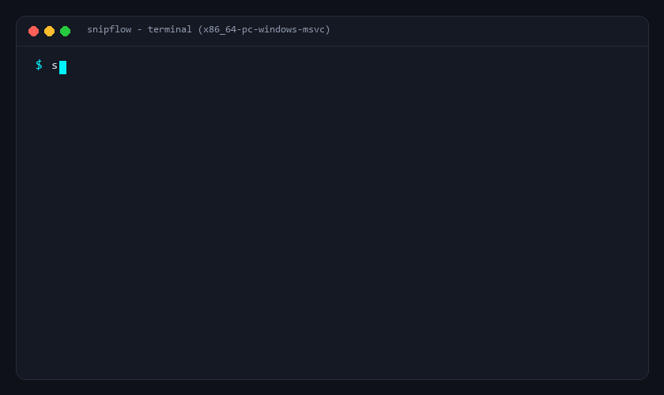

<p align="center">
  
</p>

<h1 align="center">SnipFlow</h1>

<p align="center">
  <strong>Ultra-fast, local-first lossless video clipper & silence stripper powered by Rust and FFmpeg.</strong>
  <br />
  <em>Hybrid Smart-GOP rendering. Voice-bandpass silence stripping. Industrial studio aesthetic.</em>
</p>

<p align="center">
  <a href="https://github.com/Mresyzz/SnipFlow/releases"></a>
  <a href="https://crates.io/crates/snipflow"></a>
  <a href="LICENSE"></a>
  <a href="https://www.rust-lang.org/"></a>
  
  <a href="https://github.com/Mresyzz/SnipFlow/stargazers"></a>
</p>

---

<p align="center">
  
</p>

---

## Why SnipFlow?

Conventional Non-Linear Editors (Premiere Pro, CapCut, DaVinci Resolve) treat every rough trim as a full-scale production. They force heavy project generation, proxy rendering, and destructive re-compression cycles that take minutes or hours while degrading bitrate.

Conversely, traditional open-source stream tools (such as LosslessCut or HandBrake) remain bound to cumbersome Electron wrappers or manual segment picking, offering zero automated intelligence for stream archives, raw camera dumps, or gaming captures.

SnipFlow closes this architectural gap. It merges low-latency native system performance with intelligent, heuristic pre-cut automation—executing stream operations directly at the packet layer.

| Metric / Capability | SnipFlow | LosslessCut | Premiere / CapCut | Web-Based Clippers |
| :--- | :---: | :---: | :---: | :---: |
| **Cold Start Time** | **< 0.2s (Native Rust)** | ~2.5s (Electron) | 15s – 45s (Heavy NLE) | Network dependent |
| **Memory Footprint (Idle)** | **< 45 MB** | ~280 MB | ~1.5 GB+ | ~400 MB+ |
| **Export Engine** | **Tri-Mode (`Stream Copy` / `Smart GOP` / `Exact`)** | Stream Copy | Re-encode (Lossy) | Cloud Re-encode |
| **Export Duration (1hr 4K)** | **~0.1s – 0.6s** | ~0.5s – 2s | 8 – 25 Minutes | Upload + Cloud Render |
| **Automated Silence Stripping** | **Voice-Bandpass + Auto-Calibrated dB** | Manual Only | Manual / Complex Plugin | Paywalled / Cloud Queue |
| **Peak Highlight Extraction** | **Multimodal (Audio EBU R128 + Scene Flux)** | None | None | None |
| **Headless Batch CLI** | **Built-in (`--batch`)** | Limited | Media Encoder Required | None |
| **Privacy & Security** | **100% Local-First** | 100% Local | Local (Telemetry active) | Cloud upload required |

---

## Core Architecture & Engineering Highlights

### 1. Tri-Mode Cut Engine with Hybrid Smart-GOP Rendering
Pure stream copy (`-c copy`) is physically constrained to I-frame (keyframe) boundaries. SnipFlow provides three deterministic modes selectable in both GUI and CLI:
- **`SMART GOP` (`CutMode::SmartCopy`)**: Inspects packet PTS alignment. If the In-point falls mid-GOP, SnipFlow micro-renders **only** the partial leading GOP span `[start -> first_keyframe]` (typically 0.2s–1.5s) and stitches it seamlessly to a zero-reencode stream copy `[first_keyframe -> end]` covering 99%+ of the asset.
- **`STREAM COPY` (`CutMode::StreamCopy`)**: Pure zero-reencode demux/remux passthrough with real-time millisecond GOP drift indicators (`SNAP (+120ms)`) and magnetic keyframe snapping.
- **`EXACT FRAME` (`CutMode::ExactFrame`)**: Ultra-fast full-segment render fallback (`-c:v libx264 -preset ultrafast -crf 18 -c:a copy`) for heavily damaged variable-framerate streams.

### 2. Voice-Bandpass Silence Stripper & Adaptive Noise Floor Calibration
Standard RMS energy detectors struggle with continuous low-frequency HVAC/fan hum or high-frequency mic hiss.
- **Vocal Frequency Isolation**: SnipFlow chains an `85Hz – 7800Hz` bandpass filter (`highpass=f=85,lowpass=f=7800`) prior to `silencedetect` and `volumedetect` analysis, rejecting room rumble and coil whine while leaving the exported audio stream 100% untouched.
- **One-Click Auto-Calibration**: The `AUTO CAL` probe analyzes whole-track `mean_volume` and `max_volume` distributions to compute the optimal silence threshold automatically.

### 3. Multimodal Highlight Discovery (Audio EBU R128 + Visual Scene Flux)
SnipFlow combines two orthogonal signal passes:
- **Band-Filtered EBU R128 Momentary Loudness**: Isolates vocal/action transients (`120Hz – 6000Hz`) while suppressing mechanical keyboard click spikes.
- **Keyframe Scene-Change Detection (`-skip_frame nokey`)**: Evaluates visual scene flux (`select='gt(scene,0.32)'`) directly across I-frames without decoding inter-frames, enabling accurate highlight extraction even on completely silent screen recordings.

### 4. Container Resilience & Multi-Track Stream Preservation
- **Timestamp Sanitization**: Injects `-fflags +genpts+igndts+discardcorrupt` and `-avoid_negative_ts make_zero` to heal non-monotonic DTS/PTS in raw OBS dumps or surveillance captures.
- **Safe Multi-Stream Mapping**: Maps `-map 0:v:0? -map 0:a? -map 0:s?` to preserve all multi-language / multi-channel audio tracks and subtitles while automatically stripping proprietary camera telemetry streams (`gpmd`, `tmcd`) that crash standard MP4 muxers.

---

## Installation

### Pre-built Binaries

Download pre-compiled standalone archives from the [Releases](https://github.com/Mresyzz/SnipFlow/releases) page:

- **Windows**: `snipflow-v*-x86_64-pc-windows-msvc.zip` (Zero-configuration portable bundle with static `ffmpeg.exe` and `ffprobe.exe` included)
- **macOS (Apple Silicon)**: `snipflow-v*-aarch64-apple-darwin.tar.gz`
- **macOS (Intel)**: `snipflow-v*-x86_64-apple-darwin.tar.gz`
- **Linux**: `snipflow-v*-x86_64-unknown-linux-gnu.tar.gz`

### Cargo (crates.io)

SnipFlow interfaces with FFmpeg via process-isolated pipelines—**no C headers, `libavcodec-dev`, or `PKG_CONFIG_PATH` configuration required** to compile from source:

```bash
cargo install snipflow
```

---

## Headless CLI & Batch Automation

In addition to the desktop studio GUI, SnipFlow ships with a full headless CLI for server workflows and bulk recording triage:

```bash
# Launch Desktop Studio GUI
snipflow

# Single-file automated silence strip & smart-GOP seamless merge
snipflow --cli raw_lecture.mp4 clean_lecture.mp4

# Batch process an entire directory of recordings with auto-calibrated noise floor
snipflow --batch ./raw_recordings --out-dir ./cleaned_vods --min-silence 0.5 --mode smart
```

---

## Key Shortcuts

| Shortcut | Action | Description |
| :--- | :--- | :--- |
| `Space` | **Play / Pause** | Toggle playback at standard rate |
| `←` / `→` | **Step Frame** | Move playhead backward / forward by 1 frame |
| `I` / `O` | **Mark In / Out** | Set start and end boundaries for active segment |
| `H` | **Next Peak** | Jump playhead to the next detected audio/visual highlight |
| `Enter` | **Cut Export** | Execute export using active engine mode |

---

## Roadmap

- [x] High-performance keyframe-aligned demuxing and remuxing engine
- [x] Fast RMS audio spectrum waveform generator
- [x] Real-time silence thresholding and auto-cutting preview
- [x] Multimodal audio EBU R128 + visual scene-flux highlight discovery
- [x] GOP micro-smart-rendering (`CutMode::SmartCopy` hybrid leading-GOP encode + stream copy)
- [x] Multi-track audio stream preservation and per-track silence inspection
- [x] Batch processing CLI interface (`--batch`) for headless server workflows
- [x] Vocal bandpass filtering (`85Hz–7800Hz`) and `volumedetect` noise-floor auto-calibration

---

## License

Licensed under the [GNU General Public License v3.0 (GPL-3.0-or-later)](LICENSE).
